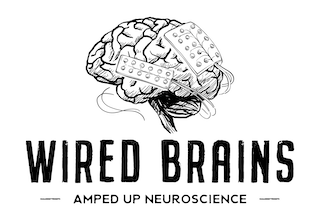

<p align="center">
  
</p>

# MEG Analysis Suite (MAS)

**MEG Analysis Suite (MAS)** is an interactive analysis, visualization, and decoding platform for magnetoencephalography (MEG) developed at the **Wired Brains Lab** at the **Medical College of Wisconsin (MCW)**. 

MAS couples an interactive PyQt5 / PyVista desktop interface for continuous recording exploration, evoked field analysis, and 3D sensor coregistration with a high-throughput CLI and HPC pipeline for neural concept decoding across sensor and source space.

---

## Key Capabilities

### 1. Interactive MEG Signal Viewer & DSP
- **Continuous & Epoch Visualization:** Multi-channel MEG browser supporting Neuromag / Elekta VectorView channel layouts (magnetometers, planar gradiometers, stimulus triggers, and EEG channels).
- **High-Performance Filtering:** Real-time zero-phase IIR/FIR filtering (bandpass, lowpass, highpass) and automatic line noise notch detection (60 Hz harmonics).
- **Multiprocessed Spectral Analysis:** Parallel Power Spectral Density (PSD) calculation using POSIX shared memory buffers (`core/shared_buffer.py`) for low-latency multi-channel spectral updates without UI freezing.

### 2. 3D Cortical Coregistration & Surface Visualization
- **Interactive 3D Brain:** PyVista- and VTK-powered 3D cortical rendering supporting FreeSurfer surfaces (`pial`, `white`, `inflated`) and BEM meshes.
- **Sensor Alignment & Parcellation:** Sensor-to-head coordinate coregistration with interactive ROI selection across Desikan-Killiany (`aparc`), Destrieux (`aparc.a2009s`), and Glasser (`HCP-MMP1`) parcellations.

### 3. Evoked Response & Stimulus-Trial Alignment
- **Event Log Synchronization:** Automatic pairing between continuous raw `.fif` files and task `events_log.csv` tables.
- **Evoked Field (ERF) Profiling:** Butterfly plots, sensor topomaps, baseline correction, and stimulus condition averaging.
- **Semantic Vector Generation:** Integration for extracting semantic feature vectors and stimulus embeddings for downstream decoding.

### 4. Neural Concept Decoding & Representation Benchmarking
- **Versatile Decoding Architectures:**
  - **Discrete Classifiers:** Pairwise linear SVMs, multi-class logistic regression, template matching, and multi-layer perceptrons (MLP).
  - **Semantic Embedding Decoders:** Linear Ridge regression, contrastive embedding alignment, and transformer architectures mapping neural activity to continuous semantic spaces.
- **Sensor & Source Spaces:** Evaluate time-resolved sensor data, volumetric source spaces, or cortical parcel band powers with saved MNE inverse operators (`-inv.fif`).
- **Cluster & HPC Scaling:** Fully headless CLI (`scripts/run_concept_decoding_cli.py`) and Slurm batch runners (`scripts/*.slurm`) configured via TOML/JSON presets for reproducible benchmark sweeps.

---

## Architecture & Directory Layout

```text
mas/
├── mas.py                          # Primary GUI application entry point
├── mas.ui                          # Qt Designer user interface specification
├── macos_qt_fixes.py               # macOS Cocoa event loop & rendering fixes
├── requirements.txt                # Core Python package dependencies
│
├── core/                           # Core application logic & decoding engine
│   ├── orchestrator.py             # Main coordinator binding UI, data, and models
│   ├── meg_signal_viewer.py        # Multi-channel time-series viewer & navigation
│   ├── meg_analysis_panel.py       # Evoked response analysis & trial inspection
│   ├── stimulus_response_report.py # Stimulus response tables & embedding exports
│   ├── fif_processing.py           # MNE FIF reading, epoching, and metadata parsing
│   ├── meg_channels.py             # Channel type normalization & sensor coordinates
│   ├── source_parcellation.py      # FreeSurfer & HCP anatomical ROI definitions
│   ├── shared_buffer.py            # High-performance shared memory IPC
│   ├── config.py / config.json     # Configuration management & default parameters
│   ├── concept_*.py                # Modular concept decoding backend (signal, source,
│   │                               #   pairwise, subsets, transformers, feature caching)
│   └── test_*.py                   # Comprehensive unit test suite
│
├── dsp/                            # Digital signal processing modules
│   ├── filtering.py                # Digital filter implementations & notch detection
│   ├── power_spectrum.py           # Multi-channel PSD calculation & plotting
│   └── psd_proc.py                 # Multi-core multiprocessing workers for PSD
│
├── viewer3d/                       # 3D visualization & coregistration
│   ├── meg_3d.py                   # PyVista/VTK cortical mesh viewer & sensor mapping
│   └── meg_integration.py          # Mixin bridging core data to the 3D surface
│
├── usercontrols/                   # Custom PyQt5 UI widgets
│   ├── pandasmodel.py              # QAbstractTableModel for Pandas DataFrames
│   ├── checkable_combobox.py       # Multi-select dropdown control
│   └── checkable_treecombobox.py   # Hierarchical multi-select tree control
│
├── configs/                        # Local & HPC benchmark presets (.toml / .json)
├── scripts/                        # Headless CLI entry points & Slurm job submission scripts
└── docs/                           # Technical guides, CLI specifications, and Sphinx docs
```

---

## Platform Support & Compatibility

> **Primary Development Platform:** MAS was developed and tested primarily on **macOS** (Apple Silicon). The suite includes native Cocoa and Qt accommodations (`macos_qt_fixes.py`) for Retina display rendering, multiprocessing spawn behavior, and macOS window integration.

- **macOS (Primary):** Fully supported on macOS 12+ (Monterey, Ventura, Sonoma, Sequoia). Native Apple Silicon (M1/M2/M3/M4) and Intel architectures run both the desktop GUI and local decoding pipelines out of the box.
- **Linux & HPC Clusters:**
  - **Headless / CLI:** Production-tested on Linux cluster environments (RHEL, Rocky Linux, Ubuntu, Slurm). All command-line decoding engines (`scripts/run_concept_decoding_cli.py`, `scripts/run_concept_benchmark.py`) run entirely headless without GUI dependencies or X11 displays.
  - **Desktop GUI:** Supported on desktop Linux with standard X11 or Wayland environments and OpenGL acceleration (`libgl1-mesa-glx`, `libglib2.0-0`).
- **Windows:**
  - Fully compatible with Windows 10 and 11 using Python 3.10/3.11.
  - Ensure vendor GPU drivers (NVIDIA, AMD, or Intel) are up to date for hardware-accelerated OpenGL in the 3D PyVista brain viewer.

---

## Installation

### Prerequisites

- **Python:** 3.10 or 3.11 recommended
- **Environment Manager:** [Conda / Mamba](https://github.com/conda-forge/miniforge) or standard Python `venv`
- **Supported Platforms:** macOS (Apple Silicon / Intel), Linux, Windows

### Setup Environment

```bash
# Clone the repository
git clone https://github.com/WiredBrainsLab/mas.git
cd mas

# Create and activate environment
conda create -n mas python=3.11 -y
conda activate mas

# Install core dependencies
pip install -r requirements.txt
```

### Optional Dependencies

- **Semantic Embedding & Transformer Decoders:**
  ```bash
  pip install torch torchvision transformers
  ```
- **HPC Cluster Requirements:**
  See [`scripts/requirements-decoding.txt`](scripts/requirements-decoding.txt) for pinned compute node packages.

---

## Quick Start

### 1. Launch the Desktop GUI

```bash
python mas.py
```

- **Open a FIF File:** Click **File $\rightarrow$ Open FIF** (or use the toolbar button) to select an Elekta/Neuromag raw recording (`*_raw.fif`).
- **Load Events:** In the **MEG Analysis** panel, pair the corresponding `events_log.csv` to partition continuous data into stimulus-locked trials.
- **Compute PSD:** Open the **Power Spectrum** dock to compute and visualize multi-channel PSD with interactive notch filtering.
- **View 3D Sensor Alignment:** Select a subject's FreeSurfer directory in the **3D Viewer** to render the reconstructed cortical surface and coregister MEG helmet sensors.

### 2. Run Headless Concept Decoding via CLI

For automated or cluster workloads, execute the CLI directly:

```bash
# Show all decoding options
python scripts/run_concept_decoding_cli.py --help

# Run a sensor-space pairwise decoding benchmark from a config preset
python scripts/run_concept_decoding_cli.py --config configs/decoding.toml

# Run source-parcel decoding with a precomputed inverse operator
python scripts/run_concept_decoding_cli.py \
  --config configs/decoding.source-volume-beta.hpc.toml \
  --torch-num-threads 4
```

### 3. Slurm HPC Job Submission

Standardized Slurm scripts matching benchmark configurations are available in `scripts/`:

```bash
sbatch scripts/decoding.slurm
sbatch scripts/decoding.source-volume-beta.slurm
```

---

## Running Unit Tests

Execute the test suite to verify data structures, epoch resampling, feature caching, and decoding backends:

```bash
python -m unittest discover -s core -p "test_*.py"
```

---

## Technical Guides & Documentation

In-depth technical guides are located in [`docs/`](docs/):

- [`docs/decoding_cli.md`](docs/decoding_cli.md): Comprehensive reference for all CLI arguments, path maps, and group modes.
- [`docs/concept_benchmark.md`](docs/concept_benchmark.md): Protocol for standardized concept decoding benchmarks and validation splits.
- [`docs/source_frequency_decoding.md`](docs/source_frequency_decoding.md): Specification for source-space frequency band power extraction.
- [`docs/time_resolved_pairwise_decoding.md`](docs/time_resolved_pairwise_decoding.md): Timecourse pairwise SVM classification workflow.
- [`docs/PSD_MULTIPROCESSING.md`](docs/PSD_MULTIPROCESSING.md): Architectural details of the shared-memory multiprocessing PSD engine.

To compile HTML documentation locally with Sphinx:

```bash
pip install -r docs/requirements.txt
python -m sphinx -M html docs/source docs/build
# Open docs/build/html/index.html in your browser
```

---

## License & Attribution

Developed by the **Wired Brains Lab**, Department of Neurosurgery, Medical College of Wisconsin.  
For research inquiries, issues, or contributions, please open an issue on the repository or contact the lab.
